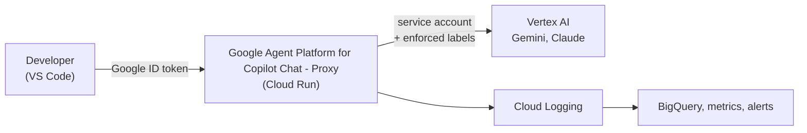

# Google Agent Platform for Copilot Chat - Proxy <!-- omit in toc -->

A governance proxy for AI coding assistants backed by **Google Cloud Vertex AI**, plus the Terraform to run it.

Developers authenticate to a central **Cloud Run proxy** instead of calling Vertex AI directly. The proxy verifies who they are, enforces which models and regions may be used, injects non-forgeable cost-attribution labels, streams the answer back without buffering, and records token usage and estimated cost for every call. It is designed for the [Google Agent Platform for Copilot Chat](https://marketplace.visualstudio.com/items?itemName=jorsm.vertex-ai-models-chat-provider) VS Code extension but speaks the native Vertex AI REST protocol, so other clients can use it too.



- [Features](#features)
- [Repository layout](#repository-layout)
- [Quick start](#quick-start)
- [Documentation](#documentation)
- [Security notes](#security-notes)

## Features

- **Authentication.** Google OIDC ID tokens; invocation rights managed with Cloud Run IAM.
- **Model and region allowlists**, with explicit effort variants (`-high`, `-medium`, `-max`). See [Governance](docs/04-governance.md).
- **100% cost attribution.** Labels enforced server-side, including one derived from the verified identity. See [Security and IAM](docs/03-security-and-iam.md).
- **Zero-buffering streaming** of SSE and chunked responses for Gemini and Claude.
- **Usage analytics.** One structured event per inference, exported to BigQuery with token, cache, latency and estimated-cost fields. No prompts or responses are stored. See [Observability](docs/08-observability.md).
- **Operations.** Log-based metrics, a dashboard, alerts, a billing budget and Cloud Trace spans per pipeline stage.
- **Infrastructure as code.** One Terraform configuration provisions everything in a dedicated hub project.

## Repository layout

| Path | Content |
| --- | --- |
| [`api/`](api) | The proxy: Python 3.14, Flask, Gunicorn, packaged with a Dockerfile; tests and deploy scripts |
| [`terraform/`](terraform) | Hub project, IAM, Cloud Run service, custom domain, BigQuery analytics, budget, metrics, alerts, tracing |
| [`docs/`](docs) | Full documentation |

## Quick start

Prerequisites: Terraform `>= 1.15.0`, the Google Cloud SDK (`gcloud`), a Google Cloud folder and billing account, and a domain you own, verified in [Search Console](https://search.google.com/search-console) before the first apply (the Cloud Run domain mapping is a Preview feature limited to some regions: see [Deployment](docs/07-deployment.md#3-custom-domain)).

```bash
# 1. Provision the hub project and the Cloud Run service
cd terraform
cp terraform.tfvars.example terraform.tfvars    # edit all placeholders
terraform init && terraform apply

# 2. Build and deploy the proxy code
cd ..
PROJECT_ID=<hub-project-id> REGION=<region> ./api/deploy.sh      # Windows: .\api\deploy.ps1 -ProjectId ... -Region ...

# 3. Check it
URL=$(terraform -chdir=terraform output -raw proxy_service_uri)
curl -H "Authorization: Bearer $(gcloud auth print-identity-token)" "$URL/health"
```

Then point your client at the proxy URL and remove direct Vertex AI permissions from users ([Deployment](docs/07-deployment.md), [Client integration](docs/10-client-integration.md)).

To work on the code:

```bash
pip install -r api/requirements.txt -r api/tests/requirements.txt
cd api && ruff check . && ruff format --check . && pytest tests
```

## Documentation

| Chapter | Topic |
| --- | --- |
| [1. Overview](docs/01-overview.md) | The problem and the solution |
| [2. Architecture](docs/02-architecture.md) | Components, request pipeline, source layout |
| [3. Security and IAM](docs/03-security-and-iam.md) | Authentication, anti-spoofing, roles |
| [4. Governance](docs/04-governance.md) | Allowlists, labels, context limit, discovery |
| [5. API reference](docs/05-api-reference.md) | Endpoints and error format |
| [6. Configuration](docs/06-configuration.md) | Environment variables, Terraform variables, outputs |
| [7. Deployment](docs/07-deployment.md) | Provisioning, deploying, rollout, upgrades |
| [8. Observability](docs/08-observability.md) | Usage events, BigQuery, metrics, alerts, traces |
| [9. Development and testing](docs/09-development-and-testing.md) | Local runs, lint, tests |
| [10. Client integration](docs/10-client-integration.md) | VS Code extension and other clients |

## Security notes

- Never commit `terraform.tfvars` or Terraform state; they contain project identifiers and identities. Use a remote state backend.
- `LOCAL_DEV_BYPASS` disables authentication and is for local development only.
- Configuring a client to use the proxy does not by itself prevent direct Vertex AI access: remove users' own Vertex AI permissions so the proxy is the only way in.
