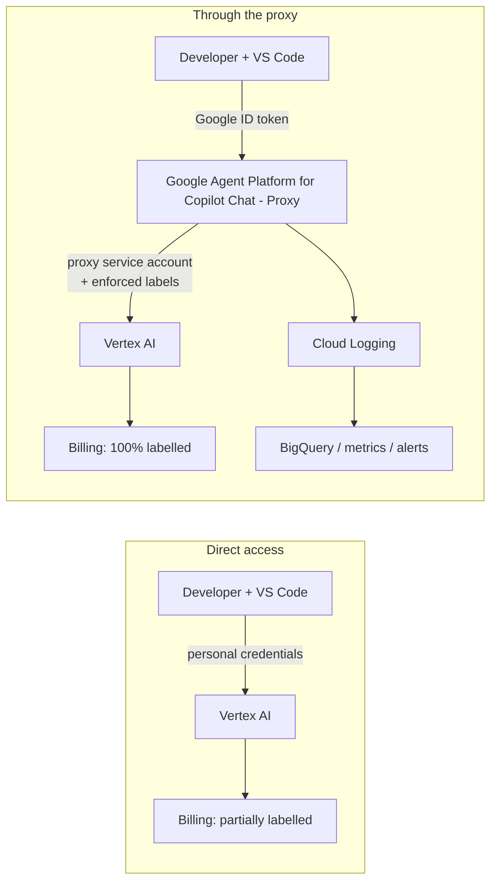

# 1. Overview <!-- omit in toc -->

- [The problem](#the-problem)
- [The solution](#the-solution)
- [As-is versus to-be](#as-is-versus-to-be)
- [Where to go next](#where-to-go-next)

## The problem

Organizations that give developers an AI coding assistant backed by **Google Cloud Vertex AI** (for example through the open-source [Google Agent Platform for Copilot Chat](https://marketplace.visualstudio.com/items?itemName=jorsm.vertex-ai-models-chat-provider) extension for VS Code) usually start with the simplest model: every developer authenticates with their own Google credentials and calls the Vertex AI REST APIs directly. This works, but it breaks down quickly:

1. **No reliable cost attribution.** Vertex AI usage can be labelled per user and per project, but the client-side setting that sends those labels is optional and under the control of each user. Significant spend ends up on the bill with no label at all, so costs cannot be split by person, team or cost center.
2. **"One Google Cloud project per user" does not scale.** Creating a project for every developer restores some attribution, but it multiplies projects, IAM bindings, log sinks and budget alerts. Third-party models (for example Anthropic Claude in Model Garden) additionally require terms acceptance and enablement per project, which forces manual steps on every developer. Models enabled in a user's project stay available indefinitely, so costly or obsolete models cannot be retired centrally.
3. **No server-side policy enforcement.** When clients call `aiplatform.googleapis.com` directly there is nowhere to reject a request that lacks attribution, to overwrite a forged identity, or to restrict which models may be used.

## The solution

The **Google Agent Platform for Copilot Chat - Proxy** is a small serverless relay deployed once, in a central *hub* project:

- Developers authenticate **to the proxy** with a Google ID token (OIDC). Cloud Run IAM decides who may invoke it.
- The proxy verifies the caller, applies the **model and region allowlists**, **injects the cost-attribution labels** (including a non-forgeable label derived from the verified identity) and forwards the call to Vertex AI using its **own service account**.
- The response is streamed back to the client with **zero buffering**, so the chat experience is unchanged.
- Every inference produces one structured **usage event** (tokens, cache usage, latency, estimated cost) that flows through Cloud Logging into BigQuery, log-based metrics, a dashboard and alerts.
- Developers no longer need (and should no longer have) direct Vertex AI permissions: the proxy is the only entry point.

This repository contains both halves of the solution:

| Directory | Content |
| --- | --- |
| [`api/`](../api) | The proxy service: a Python 3.14 Flask application packaged as a container for Cloud Run. |
| [`terraform/`](../terraform) | Infrastructure as code for the hub project: APIs, service account, Cloud Run service, IAM, custom domain, BigQuery usage analytics, budgets, metrics, dashboard, alerts and Cloud Trace storage. |

## As-is versus to-be

| Aspect | Direct access | With the proxy |
| --- | --- | --- |
| Cost attribution | Optional, set by each user | Mandatory: labels are enforced server-side |
| Identity in labels | Whatever the client sends | Derived from the verified Google token (anti-spoofing) |
| Model control | Any model enabled in the project | Central allowlist; rejected with HTTP 400 |
| Credentials | Personal credentials with broad Vertex IAM roles | Users hold only `roles/run.invoker`; the proxy service account calls Vertex |
| Third-party model terms | Accepted by every developer | Accepted once, in the hub project |
| Usage and cost tracking | Local client logs | Central events in Cloud Logging and BigQuery |
| User experience | Standard chat | Unchanged streaming latency, clearer errors |

## Where to go next

- How the pieces fit together: [Architecture](02-architecture.md)
- Who can do what: [Security and IAM](03-security-and-iam.md)
- Rules enforced on every request: [Governance](04-governance.md)
- HTTP endpoints and error format: [API reference](05-api-reference.md)
- All settings: [Configuration](06-configuration.md)
- Putting it into production: [Deployment](07-deployment.md)
- Logs, BigQuery, metrics and traces: [Observability](08-observability.md)
- Working on the code: [Development and testing](09-development-and-testing.md)
- Connecting the VS Code extension: [Client integration](10-client-integration.md)
