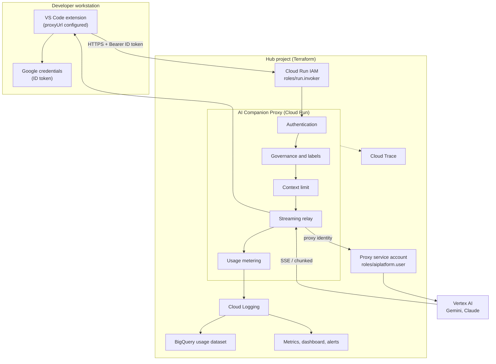
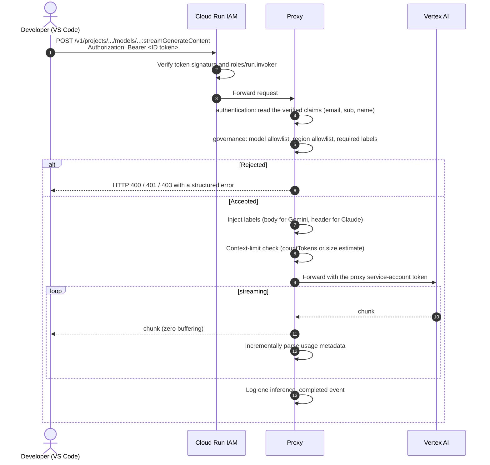

# 2. Architecture <!-- omit in toc -->

- [Components](#components)
- [Request pipeline](#request-pipeline)
- [Source layout](#source-layout)
- [Design decisions](#design-decisions)

## Components



## Request pipeline

Inference requests (`POST /v1/projects/...`) flow through these stages. Each stage is a span in Cloud Trace (see [Observability](08-observability.md)).



Every inference that reaches the proxy, including rejections and failed streams, emits exactly one `inference_completed` event. Health checks and discovery requests do not.

## Source layout

```text
api/
├── Dockerfile                 # Python 3.14 image served by Gunicorn (main:app)
├── requirements.txt           # Runtime dependencies
├── pyproject.toml             # pytest configuration
├── ruff.toml                  # Lint and format rules
├── .gcloudignore              # Files excluded from Cloud Build uploads
├── deploy.sh / deploy.ps1     # Build and deploy to Cloud Run
├── upload_openapi.sh / .ps1   # Publish the OpenAPI spec to OpenAPI Viewer
├── assets/
│   └── openapi_template.json  # OpenAPI template completed at runtime
├── src/
│   ├── main.py                # Flask app and route registration
│   ├── config.py              # Settings read from environment variables (fail fast)
│   ├── web/                   # Simple endpoints, 404/405 handling
│   ├── inference/             # Authenticate, govern, forward and meter one request
│   ├── security/              # Google ID token handling and policy enforcement
│   ├── catalog/               # Model discovery and OpenAPI document
│   ├── vertex/                # Upstream Vertex AI client (pooling, streaming)
│   ├── usage/                 # Usage parsing and cost estimation
│   └── telemetry/             # Structured logging, trace context, OpenTelemetry
└── tests/                     # pytest suite (unit, transport, tracing, live integration)

terraform/
├── providers.tf               # google and google-beta providers
├── variables.tf               # Input variables (no defaults)
├── outputs.tf                 # Service URL, service account, BigQuery objects, ...
├── main_001_[projects].tf     # Hub project
├── main_002_[services].tf     # API enablement
├── main_003_[iam].tf          # Proxy service account and roles
├── main_005_[budgets].tf      # Billing budget
├── main_005_[notification_channels].tf
├── main_007_[proxy_service].tf  # Cloud Run service, invokers, custom domain
├── main_008_[usage_analytics].tf # BigQuery dataset, log sink, normalized view
├── main_009_[observability].tf   # Log-based metrics, dashboard, alerts
├── main_010_[tracing].tf         # Cloud Trace storage
├── schemas/ai_usage_logs.json    # Bootstrap schema of the usage log table
└── sql/ai_usage_events_normalized.sql # Reporting view
```

## Design decisions

- **Stateless and horizontally scalable.** The service keeps no per-user state. Scaling is `0..20` instances with a concurrency of 8 per instance and a 300 s request timeout.
- **Cloud Run IAM is the gate.** The application does not keep its own user list; invocation rights are granted with `roles/run.invoker`. The application still validates the token to read the caller identity.
- **Streaming without buffering.** Upstream chunks are relayed as they arrive. A passive parser extracts the provider usage metadata; prompts and generated text are never stored or logged.
- **One shared HTTP connection pool per worker.** Request-specific state (headers, tokens, trace callbacks) never lives on the shared client; cookies are discarded; service-account credentials refresh under a lock.
- **Configuration from the environment only.** There are no defaults for governance settings: a missing variable stops the service at first use, so a misconfigured deployment cannot silently run unrestricted.
- **Observability without extra permissions.** The proxy writes JSON to stdout. Cloud Logging routes it to BigQuery and derives metrics; the proxy never needs BigQuery write access.
